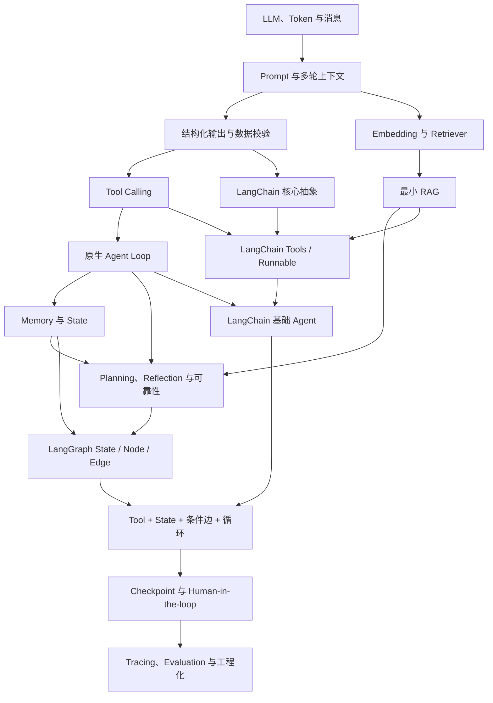

# 15 天 AI Agent 开发入门到实践：总体学习规划

> 当前阶段：第一阶段——总体规划。本文只定义学习路线、实验范围和验收标准，不展开每天的完整教材。

## 1. 课程总体说明

### 1.1 适合的学习者

本课程适合具备 Python 基础语法能力，但尚未系统学习大语言模型（Large Language Model，LLM）、AI Agent、LangChain 和 LangGraph 的学习者。学习前最好能够：

- 编写函数、类、循环和异常处理；
- 阅读和构造字典、列表与 JSON；
- 理解模块导入、文件路径和环境变量；
- 对 HTTP 请求有基本认识，但不要求熟悉异步编程、机器学习数学或模型训练。

课程遇到新概念时先给出通俗解释和生活化类比，再回到准确的技术定义、数据流与代码实现。重点不是背框架 API，而是理解每个模块为什么存在、解决什么问题，以及何时不应使用它。

### 1.2 15 天结束后能够达到的水平

完成课程后，学习者应能：

- 准确区分普通 LLM 调用、聊天机器人、Chain、Workflow、RAG 与 Agent；
- 独立调用模型 API，管理消息，实现结构化输出和 Tool Calling；
- 用原生 Python 手写带终止条件、参数校验和错误处理的基础 Agent Loop；
- 解释 Prompt、Model、Tool、Memory、State、Planning、RAG、Tracing 与 Evaluation 的职责；
- 使用 LangChain 组织模型、消息、提示词、工具、Runnable、Retriever 和基础 Agent；
- 使用 LangGraph 编排有状态、带分支、循环、Checkpoint 和人工确认的工作流；
- 看懂一个中小型 Agent 项目的主要目录、数据流、控制流和安全边界；
- 为后续开发完整 Agent 项目做出合理的技术拆分。

这一水平属于“能够独立完成小型实验并开始阅读、修改中小型 Agent 项目”，不等同于已经掌握生产级部署、大规模评估或复杂多智能体系统。

### 1.3 学习方式与课程边界

15 天课程不会连续开发一个大型综合项目。每天通过一个小型、独立、可运行的 Python 实验验证当日原理，例如消息构造器、结构化输出解析器、计算器工具、天气 Mock、Agent Loop、内存检索器和状态图。独立实验能让问题边界更清楚，也便于反复运行和调试。

课程遵循以下顺序：

1. 先理解 LLM、消息、Prompt 和 API；
2. 再手写结构化输出、工具调用、Agent Loop、状态、记忆与 RAG；
3. 理解原理后再引入 LangChain；
4. 最后使用 LangGraph 处理显式状态、分支、循环、持久化与人工确认；
5. 以工程化、Tracing、评估和项目阅读收尾。

课程结束后，可从真实需求出发，依次完成需求边界、工具清单、状态模型、流程图、风险与评估指标，再选择是否需要 RAG、LangChain 或 LangGraph，然后单独开发一个完整 Agent 项目。

## 2. 技术环境建议

### 2.1 当前已核对的环境基线

当前项目已经使用 `uv` 建立隔离环境，基线如下：

- macOS（Apple Silicon）；
- Python 3.12.13；
- `uv 0.12.0`；
- LangChain 1.3.14；
- `langchain-openai` 1.4.1；
- LangGraph 1.2.10；
- OpenAI Python SDK 2.51.0；
- Pydantic 2.13.4；
- pytest 9.1.1；
- Ruff 0.16.1。

以上是当前 `uv.lock` 的实际锁定结果，不代表课程永远要求这些版本。进入 LangChain、LangGraph 或模型 API 相关教学日之前，应再次检查当前环境和官方文档，示例代码以本项目锁定版本为准，避免混用旧教程中的废弃 API。

### 2.2 Python、虚拟环境与依赖管理

推荐 Python 3.12。它满足当前核心依赖要求，并避免使用 macOS 系统自带的 Python 3.9。项目统一使用 `uv` 管理 Python、虚拟环境、依赖声明和锁文件。

本项目已经完成以下等价步骤：

```bash
uv python install 3.12
uv sync
```

日常无需激活环境，可以直接运行：

```bash
uv run python --version
uv run python path/to/example.py
uv run pytest
uv run ruff check .
```

也可以手动激活：

```bash
source .venv/bin/activate
```

不要同时激活 Conda 环境和项目 `.venv`，否则容易混淆 Python、pip 和命令来源。

### 2.3 编辑器

推荐使用 Visual Studio Code 或 Cursor，并选择项目解释器：

```text
/Users/hkh/Desktop/project/agent学习/.venv/bin/python
```

建议开启 Python、Pylance（或等价语言服务）和 Ruff 支持。编辑器只是辅助工具，所有示例必须能从终端运行，避免依赖编辑器的隐式配置。

### 2.4 依赖安装与版本记录

核心依赖已声明在 `pyproject.toml`，精确解析结果保存在 `uv.lock`。新机器只需进入项目后运行：

```bash
uv sync
```

需要新增依赖时使用：

```bash
uv add package-name
uv add --dev package-name
```

锁定依赖版本的原因包括：

- LangChain 和 LangGraph 更新较快，导入路径和抽象可能变化；
- 同一份代码在不同版本下可能表现不同；
- 锁文件可以复现课程环境，便于定位“代码问题”还是“版本问题”；
- 每日教材可以明确标注其验证过的版本基线。

暂不提前安装向量数据库、部署 CLI 或多智能体扩展。到对应课程确有需要时，再依据官方文档添加最小依赖。

### 2.5 API Key 与 Mock 方案

真实密钥不能写入 Python 文件。需要调用模型时，将 `.env.example` 复制为 `.env`：

```bash
cp .env.example .env
```

然后填写：

```dotenv
OPENAI_API_KEY=your_key_here
OPENAI_MODEL=your_model_name
```

代码通过 `python-dotenv` 和 `os.getenv()` 读取，并在缺少配置时给出清晰提示。`.env` 已加入 `.gitignore`。没有真实 API Key 时，课程使用确定性的 Mock Model 或预制响应完成消息、解析、工具、循环和图编排实验；涉及真实模型特性的部分会明确标注差异。

### 2.6 环境验收

```bash
uv run python --version
uv lock --check
uv run python -c "import openai, langchain, langgraph, pydantic; print('环境正常')"
uv run ruff check .
```

预期结果是 Python 3.12、锁文件一致、核心模块可导入且 Ruff 无错误。API Key 是否有效应在首次真实 API 实验中单独验证，不以“模块可以导入”代替 API 连通性验收。

## 3. 15 天学习路线总表

| 天数 | 学习主题 | 核心概念 | 编程内容 | 当日实践 | 当日产出 | 与前一天的联系 | 建议时长 |
|---|---|---|---|---|---|---|---|
| Day 1 | LLM 与一次模型调用 | Token、上下文窗口、消息角色、生成机制、API | 原生 SDK、环境变量、Mock Model | 命令行问答器 | 消息与调用实验 | 起点：建立共同语言 | 2～3 小时 |
| Day 2 | 多轮消息与 Prompt | System/User/Assistant Message、Prompt、上下文成本 | 消息列表、Prompt 构造、历史裁剪 | 带角色约束的多轮助手 | Prompt 与消息实验 | 扩展 Day 1 的单次调用 | 2～3 小时 |
| Day 3 | 结构化输出 | JSON、Schema、Pydantic、解析失败 | 数据模型、校验、重试/降级 | 信息提取器 | 结构化输出实验 | 将自然语言变成可编程数据 | 3 小时 |
| Day 4 | Tool Calling 原理 | Tool、函数签名、工具协议、参数安全 | 原生工具注册、参数验证、调度 | 计算器与天气 Mock | 工具调度实验 | 结构化输出成为行动指令 | 3～4 小时 |
| Day 5 | Agent 边界与 Agent Loop | 感知—决策—行动—反馈、终止条件、ReAct | 手写循环、最大迭代、错误回传 | 最小单 Agent | 原生 Agent Loop | 将 Day 4 工具调用闭环化 | 3～4 小时 |
| Day 6 | Memory 与 State | 短期/长期记忆、状态、持久化、摘要 | 会话状态、JSON 持久化、记忆检索 | 有偏好记忆的助手 | 记忆与状态实验 | 为 Agent Loop 增加跨步骤信息 | 3 小时 |
| Day 7 | RAG 基础 | Chunk、Embedding、相似度、Retriever、Grounding | 最小向量表示或 Mock Embedding、Top-k 检索 | 本地文档问答 | 原生 Retriever/RAG | 将外部知识注入决策上下文 | 3～4 小时 |
| Day 8 | Planning、Reflection 与可靠性 | 任务分解、计划、反思、重试、超时、人工确认 | 计划数据结构、失败策略、HITL 门禁 | 带审批的执行计划器 | 可靠性实验 | 综合工具、循环、状态与检索 | 3～4 小时 |
| Day 9 | LangChain 核心抽象 | Chat Model、Messages、PromptTemplate、Structured Output | 模型调用、模板、结构化输出 | 原生版与 LangChain 版对照 | LangChain 基础实验 | 框架重组 Day 1～3 原理 | 3 小时 |
| Day 10 | Runnable、LCEL、Tools 与 Retriever | Runnable、管道、Tool、Chain、Retriever | LCEL 组合、工具封装、检索链 | 可组合问答流水线 | LangChain 组件实验 | 框架重组 Day 4 与 Day 7 | 3～4 小时 |
| Day 11 | LangChain 基础 Agent | Agent、Tool Calling、Middleware/上下文、执行边界 | 构建并测试基础 Agent | 工具型助手 | LangChain Agent 实验 | 框架实现 Day 5 的闭环 | 3～4 小时 |
| Day 12 | LangGraph 入门 | Graph、Node、Edge、State、START、END、Reducer | StateGraph、节点、普通边 | 文本处理状态机 | 基础图实验 | 显式表达 Day 6 的状态流 | 3 小时 |
| Day 13 | LangGraph 分支与循环 | 条件边、循环、Tool Node、终止控制、ReAct | 路由函数、工具节点、循环上限 | 图式工具 Agent | LangGraph ReAct 实验 | 将 Day 11 Agent 控制流显式化 | 3～4 小时 |
| Day 14 | Checkpoint 与 Human-in-the-loop | Checkpoint、线程状态、持久化、中断/恢复、人工审批 | Checkpointer、interrupt/resume、状态恢复 | 高风险工具审批流 | 可恢复工作流 | 为 Day 13 图增加可靠执行能力 | 3～4 小时 |
| Day 15 | 工程化、Tracing、评估与项目阅读 | 日志、Tracing、Eval、测试、成本、安全、目录结构 | Mock 测试、指标、故障注入、代码阅读 | 小型 Agent 项目体检 | 总结与自测报告 | 汇总全部知识形成工程视角 | 3～4 小时 |

## 4. 每天的详细规划

### Day 1：LLM 基础与第一次模型调用

1. **当日学习目标**：解释 LLM 如何基于上下文预测后续 Token；区分模型、API 和聊天界面；完成真实或 Mock 调用。
2. **必须理解的概念**：Token、上下文窗口、概率生成、消息角色、请求与响应、温度的直觉、调用成本意识。
3. **代码能力**：读取环境变量；构造客户端；发送请求；提取文本；捕获鉴权、网络和超时异常。
4. **最小可运行实验**：命令行输入问题，程序调用真实模型；无 Key 时切换到固定响应的 Mock Model。
5. **练习题方向**：Token 与字符是否等价、上下文窗口限制、API 与模型区别、补充异常处理。
6. **当日产出文件**：`day01/README.md`、`notes.md`、`examples/basic_llm_call.py`、`examples/mock_model.py`、练习与总结文件。
7. **容易出现的误区**：把一次 API 调用称为 Agent；认为模型在数据库中查找固定答案；硬编码 Key。
8. **验收标准**：能从终端运行两种模式，并解释输入如何变成消息、响应如何返回。
9. **衔接关系**：为 Day 2 的消息历史和 Prompt 提供最小模型接口。

### Day 2：消息、Prompt 与多轮对话

1. **当日学习目标**：理解 System、User、Assistant Message 的分工；控制多轮上下文和角色行为。
2. **必须理解的概念**：Prompt、消息序列、System Prompt、上下文累积、历史裁剪、提示注入初识。
3. **代码能力**：维护消息列表；构造可复用 Prompt；统计/限制历史轮次；打印实际发送数据。
4. **最小可运行实验**：一个记住会话内昵称、但超过窗口策略后裁剪旧消息的命令行助手。
5. **练习题方向**：消息顺序、System 与 User 冲突、历史无限增长的后果、修改裁剪策略。
6. **当日产出文件**：`day02/.../messages_demo.py`、`prompt_builder.py` 及当天文档。
7. **容易出现的误区**：认为 System Prompt 绝对安全；把“模型记住了”与“历史被重新发送”混为一谈。
8. **验收标准**：能展示每轮完整消息列表，并说明被保留和裁剪的内容。
9. **衔接关系**：基于 Day 1 调用；Day 3 将把自由文本响应约束为结构化数据。

### Day 3：结构化输出与数据校验

1. **当日学习目标**：让模型结果进入可靠的程序分支，而非依赖字符串猜测。
2. **必须理解的概念**：JSON、Schema、结构化输出、Pydantic、验证错误、解析失败与语义正确性的区别。
3. **代码能力**：定义 Pydantic 模型；解析 JSON；验证类型和范围；实现一次安全重试或降级结果。
4. **最小可运行实验**：从一段报名文本提取姓名、技能和学习时长；同时提供损坏 JSON 的 Mock 测试。
5. **练习题方向**：合法 JSON 与合法业务数据的区别、必填/可选字段、增加范围校验、处理多余字段。
6. **当日产出文件**：`structured_output.py`、`models.py`、解析失败测试及当天文档。
7. **容易出现的误区**：看到 JSON 外观就跳过验证；无限重试；认为结构化输出保证事实正确。
8. **验收标准**：正确输入可解析，错误类型、缺字段和非法范围均能产生可解释错误。
9. **衔接关系**：承接 Day 2 Prompt；Day 4 将结构化结果升级为工具名称和参数。

### Day 4：Tool Calling 原理与安全调度

1. **当日学习目标**：理解模型只“提出工具调用”，真正执行工具的是宿主程序。
2. **必须理解的概念**：Tool、函数 Schema、Tool Call、Tool Result、Dispatcher、参数验证、允许列表。
3. **代码能力**：定义带类型标注的工具；维护工具注册表；验证工具名和参数；序列化执行结果。
4. **最小可运行实验**：安全计算器与天气 Mock，由预制/真实模型调用指令触发。
5. **练习题方向**：模型是否直接运行函数、未知工具、除零、超范围天气天数、增加单位换算工具。
6. **当日产出文件**：`tools.py`、`tool_dispatcher.py`、`tool_call_demo.py` 及测试。
7. **容易出现的误区**：直接用 `eval()`；信任模型参数；把函数描述当成权限控制。
8. **验收标准**：合法调用成功；未知工具、非法参数和工具异常都被安全返回。
9. **衔接关系**：利用 Day 3 Schema；Day 5 将工具结果反馈给模型形成循环。

### Day 5：Agent 的边界与原生 Agent Loop

1. **当日学习目标**：准确判断什么是 Agent，并手写感知—决策—行动—反馈循环。
2. **必须理解的概念**：Agent、Autonomy、Agent Loop、ReAct、观察、行动、反馈、终止条件；LLM/聊天机器人/RAG/Workflow/Agent 的边界。
3. **代码能力**：实现有限循环；分支处理最终答案或工具调用；记录轨迹；设置最大迭代次数。
4. **最小可运行实验**：能选择计算器或天气 Mock 的单 Agent，最多运行 5 轮。
5. **练习题方向**：固定流程为何不一定是 Agent、循环何时终止、工具失败如何反馈、修改迭代上限。
6. **当日产出文件**：`agent_loop.py`、`mock_reasoning_model.py`、轨迹样例、测试和总结。
7. **容易出现的误区**：把任何 LLM 应用叫 Agent；展示隐藏思维链；没有终止条件；失败后盲目重复。
8. **验收标准**：完成至少一次“模型→工具→模型→答案”，并能证明不会无限循环。
9. **衔接关系**：组合 Day 1～4；Day 6 为循环引入显式 State 与 Memory。

### Day 6：Memory、State 与持久化

1. **当日学习目标**：区分消息历史、短期记忆、长期记忆和运行状态。
2. **必须理解的概念**：Memory、State、Working Memory、Long-term Memory、持久化、摘要、线程/会话标识。
3. **代码能力**：定义状态结构；更新而非随意覆盖字段；将非敏感偏好安全写入 JSON；按会话恢复。
4. **最小可运行实验**：助手跨程序重启记住一个用户偏好，同时将本轮步骤计数保留在短期状态。
5. **练习题方向**：State 与 Memory 区别、哪些信息不应保存、并发覆盖、增加清除单条偏好功能。
6. **当日产出文件**：`state.py`、`memory_store.py`、`memory_demo.py` 和测试。
7. **容易出现的误区**：把全部聊天原文永久保存；无用户隔离；记忆越多越好；把数据库等同于记忆策略。
8. **验收标准**：重启后只恢复预期信息，两个用户数据不混淆，损坏文件有降级处理。
9. **衔接关系**：增强 Day 5 循环；Day 7 引入面向知识的检索，不与用户记忆混用。

### Day 7：Embedding、Retriever 与最小 RAG

1. **当日学习目标**：理解 RAG 如何检索外部知识并将证据放进模型上下文。
2. **必须理解的概念**：Chunk、Embedding、Vector、相似度、Retriever、Top-k、Grounding、引用、RAG 与 Agent 的区别。
3. **代码能力**：切分文档；生成简化向量或 Mock Embedding；计算相似度；返回 Top-k；构造带来源的上下文。
4. **最小可运行实验**：对几份本地课程说明进行检索并生成带来源回答；无 Key 可完全 Mock。
5. **练习题方向**：切块过大/过小、Top-k 权衡、检索命中不等于答案正确、调整排序。
6. **当日产出文件**：`chunker.py`、`simple_retriever.py`、`rag_demo.py`、示例文档和测试。
7. **容易出现的误区**：把 RAG 自动称为 Agent；过早安装复杂向量数据库；忽略来源和“未找到”。
8. **验收标准**：不同查询得到合理片段，无相关内容时拒绝编造，并输出证据来源。
9. **衔接关系**：使用 Day 2 上下文构造和 Day 3 数据校验；Day 8 将检索作为计划中的可选能力。

### Day 8：Planning、Reflection 与可靠执行

1. **当日学习目标**：理解规划、反思、重试和人工确认分别解决的问题及其成本。
2. **必须理解的概念**：Planning、Task Decomposition、Reflection、Retry、Timeout、Fallback、Human-in-the-loop、幂等性。
3. **代码能力**：定义计划步骤；检查前置条件；对可重试错误限次退避；高风险动作前暂停并请求确认。
4. **最小可运行实验**：计划器把任务拆成若干模拟步骤，失败步骤最多重试 2 次，写操作必须人工确认。
5. **练习题方向**：哪些错误值得重试、反思何时浪费 Token、计划是否等于执行、增加取消路径。
6. **当日产出文件**：`planner.py`、`retry_policy.py`、`approval_gate.py` 和故障注入测试。
7. **容易出现的误区**：所有任务都先长篇规划；无限反思；把重试当万能修复；人工确认只做 UI 不做门禁。
8. **验收标准**：成功、可重试失败、不可重试失败、拒绝审批四条路径均可复现。
9. **衔接关系**：综合 Day 4～7 的能力；Day 9 开始观察框架如何封装已理解的组件。

### Day 9：LangChain 核心抽象

1. **当日学习目标**：理解 LangChain 解决的组件标准化与组合问题，并与原生实现对照。
2. **必须理解的概念**：Chat Model、Messages、PromptTemplate、Structured Output、模型集成包；框架边界。
3. **代码能力**：使用当前版本导入路径；调用 Chat Model；渲染模板；获得 Pydantic 结构化结果；替换 Mock。
4. **最小可运行实验**：把 Day 3 信息提取器分别用原生 SDK 与 LangChain 实现并比较。
5. **练习题方向**：LangChain 是否是模型、集成包为何拆分、框架封装了什么、何时原生代码更合适。
6. **当日产出文件**：`native_extractor.py`、`langchain_extractor.py`、`comparison.md` 和测试。
7. **容易出现的误区**：使用旧版导入路径；一上框架就忽略请求/响应；认为使用 LangChain 就是 Agent。
8. **验收标准**：两版输入输出契约一致，能指出 LangChain 减少和增加的复杂度。
9. **衔接关系**：重组 Day 1～3；Day 10 引入组件组合、工具和 Retriever。

### Day 10：Runnable、LCEL、Tools 与 Retriever

1. **当日学习目标**：掌握 LangChain 可组合接口，同时区分 Chain 与 Agent。
2. **必须理解的概念**：Runnable、LCEL、Pipe、Chain、Tool、Retriever、同步调用与数据契约。
3. **代码能力**：用 LCEL 组合模板、模型和解析器；用装饰器/Schema 定义工具；封装自定义 Retriever。
4. **最小可运行实验**：构建固定的“问题→检索→Prompt→回答”流水线，并与普通 Python 函数组合对照。
5. **练习题方向**：固定 LCEL 为什么不一定是 Agent、节点输入不匹配、并行/回退概念、替换 Retriever。
6. **当日产出文件**：`native_pipeline.py`、`lcel_pipeline.py`、`tools_demo.py` 和测试。
7. **容易出现的误区**：管道越长越高级；输入输出类型靠猜；为两三个函数强行引入框架。
8. **验收标准**：能追踪每个 Runnable 的输入输出，并说明固定链没有自主循环。
9. **衔接关系**：框架化 Day 4、7；Day 11 使用这些 Tool 构建真正的 Agent Loop。

### Day 11：LangChain 基础 Agent

1. **当日学习目标**：用当前 LangChain API 创建工具型 Agent，并理解其运行轨迹与控制边界。
2. **必须理解的概念**：Agent、Tool Calling、Agent State、上下文、工具错误、最大步数/递归限制、框架封装层。
3. **代码能力**：注册工具；传入模型；调用 Agent；查看消息/轨迹；用 Mock 测试确定性路径。
4. **最小可运行实验**：计算器与天气 Mock 助手，演示直接回答、单次工具、工具失败三条路径。
5. **练习题方向**：与 Day 5 原生循环对照、参数验证位置、工具描述影响、添加只读工具。
6. **当日产出文件**：`native_agent.py`、`langchain_agent.py`、`agent_tests.py`、对照说明。
7. **容易出现的误区**：忽略框架内部循环；开放危险工具；只测试“成功演示”；依赖已废弃的旧 Agent API。
8. **验收标准**：三条路径可重复运行，非法参数不会触达工具主体，能画出框架执行流。
9. **衔接关系**：框架化 Day 5；Day 12 用 LangGraph 显式描述状态和控制流。

### Day 12：LangGraph 的 Graph、State、Node 与 Edge

1. **当日学习目标**：理解为什么复杂有状态流程需要显式图，而普通 `if/while` 有时已经足够。
2. **必须理解的概念**：Graph、Node、Edge、State、START、END、Reducer、编译与执行。
3. **代码能力**：定义 Typed State；编写纯节点函数；添加边；使用 Reducer 合并列表状态；编译和调用图。
4. **最小可运行实验**：文本经过清洗、分类和摘要三个节点的状态机，不调用真实模型也可运行。
5. **练习题方向**：State 字段所有权、节点返回局部更新、Reducer 与覆盖、交换节点顺序。
6. **当日产出文件**：`plain_workflow.py`、`basic_graph.py`、`state_models.py`、图测试。
7. **容易出现的误区**：把节点当任意全局副作用函数；所有字段都追加；图比普通代码天然更好。
8. **验收标准**：能逐节点打印状态变化，解释 START/END 和 Reducer 的实际作用。
9. **衔接关系**：显式化 Day 6 状态与 Day 8 工作流；Day 13 加入条件边、工具与循环。

### Day 13：条件边、循环、Tool Node 与 ReAct

1. **当日学习目标**：使用状态路由和循环表达“模型判断是否调用工具”的 ReAct 控制流。
2. **必须理解的概念**：Conditional Edge、Router、Loop、Tool Node、ReAct、终止判断、递归限制。
3. **代码能力**：编写路由函数；连接模型节点和工具节点；处理 Tool Message；设置循环上限。
4. **最小可运行实验**：LangGraph 版计算/天气 Agent，与 Day 5、11 的实现对照。
5. **练习题方向**：条件边返回值错误、工具结果如何回到模型、循环终止、增加未知工具分支。
6. **当日产出文件**：`react_graph.py`、`routing.py`、`graph_tests.py`、三版对照图。
7. **容易出现的误区**：路由函数执行副作用；只依赖模型承诺停止；混淆 Tool Node 与模型节点。
8. **验收标准**：直接回答、工具调用、工具失败、达到上限四条路径均有确定结果。
9. **衔接关系**：组合 Day 11 Tool Agent 与 Day 12 图；Day 14 增加跨运行恢复和审批。

### Day 14：Checkpoint、持久化与 Human-in-the-loop

1. **当日学习目标**：让图在中断后恢复，并在高风险节点前真正等待人工决定。
2. **必须理解的概念**：Checkpoint、Thread ID、Persistence、Interrupt、Resume、Human-in-the-loop、状态快照。
3. **代码能力**：配置适合教学的 Checkpointer；使用线程标识；触发中断；带命令恢复；查看状态历史。
4. **最小可运行实验**：模拟“发送通知”工具，执行前暂停；批准后继续，拒绝后走安全结束分支。
5. **练习题方向**：Checkpoint 与 Memory 区别、线程 ID 冲突、恢复时输入、增加修改参数后批准路径。
6. **当日产出文件**：`checkpoint_demo.py`、`approval_graph.py`、`resume_demo.py` 和恢复测试。
7. **容易出现的误区**：仅打印“请确认”却继续执行；复用同一线程 ID；在状态中保存敏感信息。
8. **验收标准**：进程内至少演示暂停、查看状态、批准/拒绝恢复；状态不会串线程。
9. **衔接关系**：强化 Day 13；Day 15 从工程角度测试、追踪和评估整个系统。

### Day 15：工程化、Tracing、评估与项目阅读

1. **当日学习目标**：建立“可运行不等于可靠”的工程意识，并能系统阅读中小型 Agent 项目。
2. **必须理解的概念**：Logging、Tracing、Evaluation、Dataset、Metric、Token/成本、延迟、可观测性、基础安全边界。
3. **代码能力**：结构化日志；Mock 单元测试；故障注入；工具/路由测试；记录延迟与调用次数；追踪可选启用。
4. **最小可运行实验**：对一个给定小型 Agent 骨架做体检，定位无限循环、未验证参数、缺少超时和难测试耦合。
5. **练习题方向**：确定性与非确定性评估、离线/在线指标、成本与质量权衡、阅读陌生项目入口。
6. **当日产出文件**：`tests/`、`evals/mini_dataset.json`、`evaluation.py`、`project_reading_report.md`、总复盘。
7. **容易出现的误区**：只看最终答案；把日志当 Tracing；只做一次人工试跑；记录密钥或敏感 Prompt。
8. **验收标准**：完成总自测，能从入口追踪一次请求，并提出至少 3 个有证据的可靠性改进点。
9. **衔接关系**：汇总 Day 1～14；下一阶段可以根据真实需求单独设计完整 Agent 项目。

## 5. 知识依赖关系



关键依赖可以简化为：

- LLM API → 消息/Prompt → 结构化输出 → Tool Calling；
- Tool Calling + Agent Loop + 终止条件 → 基础 Agent；
- Chunk + Embedding + Retriever → RAG；
- Memory 关注跨时信息使用策略，State 关注当前运行的显式数据；
- State + Workflow → LangGraph 基础图；
- Tool + State + Conditional Edge + Loop → 图式 ReAct Agent；
- Checkpoint + Interrupt/Resume → 可恢复的 Human-in-the-loop；
- 所有能力最终都需要日志、测试、Tracing、评估、成本与安全约束。

LangChain 和 LangGraph 不是并列替代品：LangChain提供模型、消息、工具和 Runnable 等组件抽象；LangGraph更关注有状态控制流和运行编排。简单任务可以只用原生 Python 或 LangChain，不必强行使用图。

## 6. 课程目录结构

第二阶段按天生成时，计划采用以下结构；本阶段不提前创建这些目录：

```text
agent学习/
├── README.md
├── 00_15天AI_Agent学习规划.md
├── pyproject.toml
├── uv.lock
├── .python-version
├── .env.example
├── common/
│   ├── config/
│   ├── mocks/
│   └── utils/
├── day01/
│   ├── README.md
│   ├── notes.md
│   ├── examples/
│   │   ├── example_01.py
│   │   └── example_02.py
│   ├── exercises/
│   │   ├── exercise.md
│   │   └── solution.py
│   └── summary.md
├── day02/
│   └── ...
├── ...
├── day15/
│   └── ...
└── tests/
```

- 根目录 `README.md`：课程入口、学习方法、运行方式和整体进度索引。
- `00_15天AI_Agent学习规划.md`：本文件，作为课程范围和顺序的审核基准。
- `pyproject.toml`：声明 Python 版本、运行依赖、开发依赖和工具配置。
- `uv.lock`：记录精确依赖版本，保证课程可复现。
- `.python-version`：提示项目使用 Python 3.12。
- `.env.example`：只展示环境变量字段，不保存真实密钥。
- `common/config/`：经过多天验证后才抽取的公共配置加载逻辑，避免第一天就过度封装。
- `common/mocks/`：无 API Key 时使用的确定性 Mock Model、Mock Tool 和测试数据。
- `common/utils/`：确实被多天复用的少量安全工具函数。
- `dayXX/README.md`：当天主教材，包括目标、原理、运行方式、调试和练习入口。
- `dayXX/notes.md`：概念笔记、术语表和原理补充。
- `dayXX/examples/`：完整、短小、可单独运行的示例。
- `dayXX/exercises/`：练习题和参考实现；答案与题目适当分离。
- `dayXX/summary.md`：当日总结、自测清单、遗留问题和与下一天的衔接。
- 根目录 `tests/`：跨模块测试或 Day 15 工程化练习；当天局部测试也可放在对应目录。

每天目录相互独立，不默认依赖前一天生成的业务代码；只在确有价值时复用 `common/`，以防课程演变成一个连续 15 天的大项目。

## 7. 总体验收标准

完成 15 天后，逐项自测：

- [ ] 我能用通俗语言和正式定义解释 LLM、Token 与上下文窗口。
- [ ] 我能准确解释 Agent 与一次 LLM 调用的区别。
- [ ] 我能区分聊天机器人、Chain、Workflow、RAG 和 Agent。
- [ ] 我能通过环境变量独立调用模型 API，并处理鉴权、网络和超时错误。
- [ ] 我能维护多轮消息，并说明上下文长度与成本影响。
- [ ] 我能用 Pydantic 实现结构化输出校验并处理解析失败。
- [ ] 我能定义工具、描述参数、校验调用并安全返回工具错误。
- [ ] 我能手写带最大迭代次数和明确终止条件的基础 Agent Loop。
- [ ] 我能解释短期记忆、长期记忆、消息历史和 State 的差别。
- [ ] 我能实现一个不依赖复杂向量数据库的简单 Retriever/RAG。
- [ ] 我知道 Planning、Reflection、Retry 和 Human-in-the-loop 各自适用的场景。
- [ ] 我能使用 LangChain 组织 Prompt、Messages、Model、Structured Output、Runnable、Tool 和 Retriever。
- [ ] 我能说明什么时候不值得使用 LangChain。
- [ ] 我能用 LangChain 构建并测试一个基础工具 Agent。
- [ ] 我能使用 LangGraph 定义 State、Node、Edge、START、END 和 Reducer。
- [ ] 我能实现条件边、循环、Tool Node 和图式 ReAct Agent。
- [ ] 我能为 Agent 设置最大循环、参数允许列表、超时、重试和异常处理。
- [ ] 我能使用 Checkpoint 和线程标识恢复状态。
- [ ] 我能实现真正会暂停的 Human-in-the-loop 审批流。
- [ ] 我能通过日志和轨迹定位一次工具调用失败发生在哪个步骤。
- [ ] 我能为工具、路由、状态更新和循环边界编写 Mock 测试。
- [ ] 我具备 Token、调用次数、延迟和成本意识。
- [ ] 我能识别提示注入、错误工具调用、敏感信息泄漏和无限循环等基础风险。
- [ ] 我能从入口文件开始读懂一个中小型 Agent 项目的数据流与控制流。
- [ ] 我能根据需求判断应使用原生 Python、LangChain、LangGraph、RAG 或普通 Workflow。

如果关键项无法独立完成，应回到对应学习日重做最小实验，而不是立即开始大型项目。

## 8. 需要学习者审核的问题

请在进入第二阶段前确认或修改以下内容：

1. 每天投入 2～4 小时是否符合实际时间？是否需要把高强度日拆开？
2. 真实模型实验准备使用 OpenAI API、OpenAI 兼容接口，还是全程优先 Mock？
3. Day 7 的 RAG 比例是否合适？是否希望增加一天、减少框架内容，深入检索与引用？
4. LangChain（Day 9～11）和 LangGraph（Day 12～14）各 3 天的比例是否合适？
5. 是否希望强化 Day 4～8 的原生 Python Agent 实现，并相应压缩框架内容？
6. 是否需要增加异步调用内容？当前规划以同步调用为主，异步只作为可选扩展。
7. 测试、Tracing 与评估集中在 Day 15，前面每天也会有小测试；是否需要提高测试比重？
8. 当前不包含部署、Web UI、Docker 和云平台，是否同意将其留到后续完整项目阶段？
9. 哪几天希望增加练习强度：Tool Calling、Agent Loop、RAG、LangChain 还是 LangGraph？
10. 是否同意每次只生成一天教材，完成并审核后再继续下一天？

---

**请先审核总体规划。确认或修改规划后，再执行第二阶段，逐天生成详细教材。**
