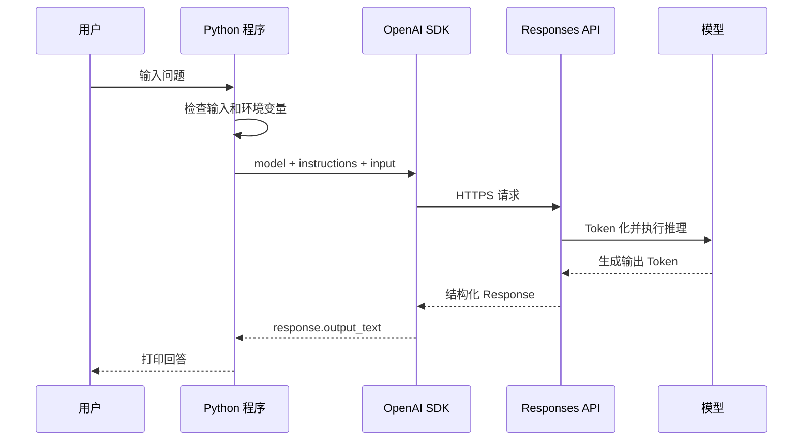

# Day 1：认识大语言模型与完成第一次模型调用

> 适用环境：Python 3.12；OpenAI Python SDK 2.51.0；项目根目录的同一个
> `uv` 虚拟环境。本文不把一次模型调用称为 Agent。

## 1. 今日学习目标

完成今天的学习后，你应该能够：

1. 用通俗语言和较正式的定义解释大语言模型（Large Language Model，LLM）。
2. 解释 Token、上下文窗口（Context Window）和消息角色的基本作用。
3. 描述模型生成文字的基本过程，知道它不是从数据库里复制固定答案。
4. 区分“模型”“模型 API”“聊天产品”和“Agent”。
5. 使用环境变量安全配置 API Key 和模型名。
6. 运行一次 OpenAI Responses API 调用，并处理常见异常。
7. 在没有 API Key 时，用 Mock Model 完成相同的数据流学习。

今天只研究最小的模型调用。工具、记忆、规划、行动循环等 Agent 能力将在后续课程逐步加入。

## 2. 前置知识检查

先尝试独立回答，再展开答案。

### 问题

1. Python 函数的参数和返回值分别有什么作用？
2. JSON 中的对象在 Python 中通常对应什么类型？
3. HTTP 请求大致包含什么，响应又大致包含什么？
4. 为什么 API Key 不应直接写进 `.py` 文件？
5. `os.getenv("NAME")` 在环境变量不存在时通常返回什么？

<details>
<summary>查看简要答案</summary>

1. 参数把数据传入函数，返回值把处理结果交给调用者。
2. 通常对应 `dict`，数组通常对应 `list`。
3. 请求包含地址、方法、请求头和可选请求体；响应包含状态码、响应头和响应体。
4. 源码可能被提交、分享或记录，密钥泄漏后可能产生数据和费用风险。
5. 默认返回 `None`；也可以通过第二个参数指定默认值。

</details>

如果这些概念不熟悉，不必停止课程。运行今天的示例时，重点观察数据在哪里进入、在哪里返回。

## 3. 核心概念讲解

### 3.1 大语言模型（Large Language Model，LLM）

#### 通俗解释

LLM 可以看成一个非常强的“续写器”：它读入已有内容，然后根据训练中学到的语言规律，选择接下来更合适的文字。不断重复这个过程，就形成了回答。

#### 正式定义

大语言模型是一类在大规模文本或多模态数据上训练的参数化概率模型。对给定上下文，它估计后续 Token 的条件概率分布，并按解码策略产生一个或多个 Token。

可以用一个简化表达描述：

```text
P(下一个 Token | 当前上下文)
```

这里不要求推导公式，只需理解：输出受上下文和概率分布影响，不是固定查表。

#### 生活化类比

想象一位读过大量资料的文字接龙选手。你给出开头，他会根据语境选择自然的后续。类比的边界是：模型没有人的生活经历，也不能仅凭语言流畅就保证事实正确。

#### 在 Agent 中的作用

LLM 往往充当 Agent 的“决策组件”：理解输入、判断是否使用工具、选择下一步或组织最终答案。但模型本身不自动拥有工具权限、长期记忆或可靠行动能力。

#### 最小示例

```python
response = client.responses.create(
    model=model_name,
    input="用一句话解释大语言模型。",
)
print(response.output_text)
```

#### 常见误区

- **误区：模型存储了每个问题的标准答案。** 实际上它根据上下文生成结果。
- **误区：回答越流畅越真实。** 语言质量与事实正确性不是一回事。
- **误区：LLM 就是 Agent。** LLM 可以是 Agent 的一个组件，但单次生成不是完整 Agent。

### 3.2 Token（词元）

#### 通俗解释

模型不是直接按“字数”或“单词数”阅读，而是先把文本切成一段段可编号的小单位，这些单位就是 Token。

#### 正式定义

Token 是分词器（Tokenizer）把输入转换得到的离散符号单位。模型处理的是 Token ID 序列，而不是原始字符串。

#### 生活化类比

快递系统不会搬运“一个地址的含义”，而会把地址拆成可处理的字段。Tokenizer 也把文本拆成模型词表中的单位。

#### 在 Agent 中的作用

Prompt、消息历史、工具描述、检索内容和模型输出都会占用 Token。Agent 循环每多一轮，通常都会增加上下文和成本，因此需要预算与终止条件。

#### 简单示例

```text
原文：AI Agent 很有趣
Token：具体切分取决于所用模型的 tokenizer，不能简单等同于字或单词。
```

#### 常见误区

- 中文一个汉字不保证恒等于一个 Token。
- 字符数、单词数与 Token 数不能简单一一换算。
- 不同模型可能使用不同词表和切分规则。

### 3.3 上下文窗口（Context Window）

#### 通俗解释

上下文窗口是模型一次能够“放在桌面上同时参考”的内容容量。

#### 正式定义

上下文窗口是单次推理中模型能够处理的 Token 总范围，通常包含输入、历史消息、工具定义、检索内容，以及需要为输出预留的空间。具体限制取决于模型。

#### 生活化类比

办公桌再大也有限。资料堆满后，需要删除、摘要或归档部分内容，才能放入新资料。

#### 在 Agent 中的作用

Agent 会积累观察、工具结果和历史状态。若不管理上下文，可能超出限制、提高延迟和费用，甚至让无关信息干扰决策。

#### 简单示例

```text
System 指令 + 用户问题 + 历史消息 + 工具说明 + 检索片段 + 输出预算
                         都会竞争上下文空间
```

#### 常见误区

- 上下文窗口不是长期记忆。
- 能装下不代表应该全部放进去。
- 窗口大小不是模型质量的唯一指标。

### 3.4 消息角色与指令

#### 通俗解释

不同消息角色告诉模型“这段话来自谁、承担什么作用”。今天的真实示例用 `instructions` 给出高层行为要求，用 `input` 提供本次用户问题。

#### 正式定义

消息或输入项是 API 请求中的结构化上下文。系统/开发者级指令用于设定行为边界，用户输入表达当前需求，模型输出承载生成结果。不同 API 的具体字段表达可能不同。

#### 生活化类比

餐厅里，“卫生规范”与“顾客点单”都影响厨师行动，但来源、优先级和目的不同。

#### 在 Agent 中的作用

Agent 后续会把工具结果、状态和历史消息组织进模型上下文。清楚消息来源是控制数据流和排查问题的基础。

#### 最小示例

```python
response = client.responses.create(
    model=model_name,
    instructions="你是一名耐心的 AI 入门导师。",
    input="Token 是什么？",
)
```

#### 常见误区

- 指令不是绝对安全边界，不能替代权限控制和参数校验。
- 把所有背景塞进一条用户消息会降低可维护性。
- 今天的一次请求不等于已经实现多轮记忆。

### 3.5 模型、API、聊天产品与 Agent 的区别

| 名称 | 它是什么 | 今天是否实现 |
|---|---|---|
| 模型 | 根据输入产生输出的计算模型 | 通过远程服务或 Mock 使用 |
| API | 程序访问模型服务的接口 | 是，Responses API |
| SDK | 对 HTTP API 的 Python 封装 | 是，`openai` 包 |
| 聊天产品 | 带界面、账号、历史等能力的完整产品 | 否 |
| Agent | 能围绕目标进行决策、行动和反馈的系统 | 否，Day 5 才手写最小循环 |

调用一次模型的流程是：

```text
用户输入 -> Python 程序 -> SDK -> HTTPS API -> 模型推理 -> API 响应 -> Python 输出
```

它没有选择工具、执行动作、观察工具结果后再决策，所以今天不要把它称为 Agent。

## 4. 工作原理



逐步解释：

1. `input()` 得到 Python 字符串。
2. 程序拒绝空输入，并从环境变量读取 Key 与模型名。
3. SDK 将 Python 参数转换为 HTTP 请求；Key 用于鉴权。
4. 服务端将文本转换为 Token，模型根据上下文生成输出。
5. SDK 把响应转换为 Python 对象。
6. 程序读取 `response.output_text`，而不是打印整个复杂对象。
7. 任一网络或服务步骤都可能失败，因此必须处理异常。

Mock 路径会跳过 SDK、网络和真实模型：

```text
用户输入 -> Python 程序 -> MockModel.generate() -> 固定规则回复
```

Mock 不能证明真实模型效果，但能稳定验证接口、控制流与错误处理。

## 5. 环境准备

### 5.1 目录位置

先进入课程根目录：

```bash
cd "/Users/hkh/Desktop/project/agent学习"
```

Day 1 使用根目录现有的 `.venv` 和 `uv.lock`，不创建 `day01/.venv`。

### 5.2 同步依赖

```bash
uv sync
```

当前 Day 1 所需包已在根目录依赖中：

- `openai`：OpenAI 官方 Python SDK；
- `python-dotenv`：从根目录 `.env` 加载环境变量；
- `pytest`：运行当天测试；
- `ruff`：检查 Python 代码。

### 5.3 配置环境变量

没有 API Key 时直接跳到 Mock 示例。需要真实调用时：

```bash
cp .env.example .env
```

在 `.env` 中填写：

```dotenv
OPENAI_API_KEY=你的真实密钥
OPENAI_MODEL=你的账户可用模型名
```

不要把 Key 发到聊天中，也不要提交 `.env`。模型名不在教材中写死，因为账户权限、模型可用性和成本会变化，应由学习者明确配置。

### 5.4 验证环境

```bash
uv run python --version
uv run python -c "import openai, dotenv; print(openai.__version__)"
uv run python -m pytest day01/tests
```

预期：Python 为 3.12，模块导入成功，测试全部通过。

## 6. 最小可运行示例

### 6.1 示例一：无 Key 的 Mock Model

文件：`day01/examples/mock_model.py`

运行：

```bash
uv run python day01/examples/mock_model.py
```

输入：

```text
你好
```

预期输出：

```text
请输入问题：你好
模型回答：你好！我是 Day 1 的 Mock Model。
```

代码分为三层：

1. `MockResponse` 模拟真实响应对象上的 `output_text` 字段。
2. `MockModel.generate()` 检查输入，并按固定规则生成可预测结果。
3. `main()` 只负责终端输入输出和把异常转换成可读提示。

### 6.2 示例二：真实 Responses API

文件：`day01/examples/basic_llm_call.py`

运行：

```bash
uv run python day01/examples/basic_llm_call.py
```

示例的核心调用：

```python
response = client.responses.create(
    model=model_name,
    instructions="你是一名耐心的 AI 入门导师。请用简洁中文回答。",
    input=normalized_input,
)
answer = response.output_text
```

预期输出的具体文字会变化，例如：

```text
请输入问题：什么是 Token？
模型回答：Token 是模型处理文本时使用的基本单位……
```

真实模型输出具有非确定性，因此不要把完整回答写成严格相等的测试断言。

### 6.3 常见报错

| 现象 | 常见原因 | 处理方法 |
|---|---|---|
| `缺少环境变量 OPENAI_API_KEY` | 未创建 `.env` 或字段为空 | 配置 `.env`，或先运行 Mock |
| `缺少环境变量 OPENAI_MODEL` | 没有显式选择模型 | 填写账户可用的模型名 |
| 鉴权失败 | Key 无效、复制错误或已撤销 | 重新核对 Key，不要打印它 |
| 连接失败/超时 | 网络、代理或服务异常 | 先测试网络，稍后重试 |
| 速率或额度限制 | 请求过快或账户额度不足 | 降低频率并查看账户限制 |
| API 错误状态 | 模型不可用、参数错误等 | 记录状态码，核对官方文档 |
| 没有可显示文本 | 响应不含普通文本输出 | 检查完整响应类型和请求配置 |

### 6.4 可选：使用 DeepSeek API

DeepSeek 官方提供 OpenAI 兼容接口，但当前官方 Python 示例使用
`client.chat.completions.create()`，与本日 OpenAI 示例使用的 Responses API
不是同一个端点。课程因此保留两个独立文件，方便比较，不假设不同厂商完全兼容。

先在根目录 `.env` 中配置一枚**未曾公开的新密钥**：

```dotenv
DEEPSEEK_API_KEY=你的新密钥
DEEPSEEK_BASE_URL=https://api.deepseek.com
DEEPSEEK_MODEL=deepseek-v4-flash
```

然后运行：

```bash
uv run python day01/examples/deepseek_llm_call.py
```

不要使用曾发送到聊天、截图、日志或代码仓库中的密钥。DeepSeek 模型名和
接口能力可能更新，实际使用前以 DeepSeek 官方文档为准。

## 7. 原理版与框架版对照

Day 1 不使用 LangChain 或 LangGraph。原因不是框架不好，而是今天需要看清楚最基础的数据流：

```text
字符串 -> SDK 请求 -> Response 对象 -> output_text
```

过早引入框架会同时出现 Chat Model、Messages 和 Runnable 等抽象，容易把“模型 API 调用”和“框架封装”混在一起。

今天的两种实现承担不同角色：

| 实现 | 优点 | 局限 |
|---|---|---|
| Mock Model | 免费、稳定、适合测试错误分支 | 不具备真实语言能力 |
| 原生 SDK | 接近真实 API 数据流、抽象较少 | 需要 Key、网络和额度 |

Day 9 才会把原生实现与 LangChain Chat Model 做正式对照。

## 8. 当日小型实践

实践题位于 [exercises/exercise.md](exercises/exercise.md)：实现一个通过 `USE_REAL_MODEL` 在 Mock 与真实模型之间切换的命令行问答器。

- **任务目标**：理解依赖反转的最小形式——上层只需要“问题进、文本出”，不必关心底层是真模型还是 Mock。
- **输入**：一段非空文本。
- **输出**：模型回答或清晰错误。
- **实现步骤**：先 Mock，后模式选择，再接入真实函数，最后测试。
- **验收方法**：Mock 模式无 Key 可运行；`uv run python -m pytest day01/tests` 全部通过。
- **可选扩展**：显示当前模式、记录耗时、统计字符数。

参考实现位于 `day01/exercises/solution.py`。本项目当前将真实模式接到
DeepSeek 的 `ask_deepseek()`；Mock 模式仍不需要密钥。建议先独立完成，再阅读答案。运行方式：

```bash
uv run python -m day01.exercises.solution
```

## 9. 练习题

### 9.1 概念题

1. 为什么“调用一次 LLM API”不能直接称为 Agent？
2. Token 与汉字、字符或英文单词是否一一对应？为什么？
3. 上下文窗口与长期记忆有什么不同？

### 9.2 代码阅读题

4. 阅读以下代码：当环境变量缺失时，会发生什么？为什么比直接把 Key 写进代码更好？

   ```python
   api_key = os.getenv("OPENAI_API_KEY", "").strip()
   if not api_key:
       raise ValueError("缺少 API Key")
   ```

5. 阅读以下代码：为什么 `response.output_text` 比直接 `print(response)` 更适合作为终端答案？

   ```python
   response = client.responses.create(model=model_name, input="你好")
   print(response.output_text)
   ```

### 9.3 代码修改题

6. 修改 `MockModel.generate()`：输入含“Token”时，返回“Token 是模型处理文本的基本单位。”，并增加测试。

### 9.4 开放思考题

7. 如果同一个问题两次得到不同但都合理的回答，这一定是 Bug 吗？哪些场景需要更稳定的输出？

## 10. 调试与常见错误

### 10.1 推荐排查顺序

1. **确认位置**：运行 `pwd`，确保位于课程根目录。
2. **确认解释器**：运行 `uv run python --version`，避免误用系统 Python。
3. **确认依赖**：运行 `uv sync` 和最小 `import`。
4. **先跑 Mock**：若 Mock 都失败，优先修复 Python 路径或代码问题。
5. **只检查配置是否存在**：不要打印 Key 内容。
6. **区分错误类别**：鉴权、超时、连接、限流、API 状态分别处理。
7. **记录必要信息**：时间、异常类型、状态码、模型名；不要记录密钥。
8. **最后再重试**：只有临时网络/限流问题适合有限重试，配置错误不应盲目重试。

### 10.2 如何使用日志定位

Day 1 暂不抽取公共日志初始化。可以先用不会泄密的输出理解定位方法：

```python
print(f"准备调用模型：{model_name}")
print(f"输入字符数：{len(user_input)}")
```

禁止这样做：

```python
print(api_key)  # 会泄漏密钥
```

后续工程化课程会改用标准 `logging`、结构化字段和 Tracing。

## 11. 今日总结

- **今天学了什么**：LLM、Token、上下文窗口、消息/指令、API、SDK 与 Mock。
- **这些知识解决什么问题**：建立模型调用的真实心智模型，能独立配置、运行和排错。
- **与 Agent 有什么关系**：LLM 是 Agent 的核心组件之一，但今天没有工具、行动或反馈循环，因此还不是 Agent。
- **明天学什么**：在一次调用之上加入消息角色、Prompt 和多轮历史，理解上下文如何持续增长。

## 12. 自测清单

- [ ] 我能用自己的话解释 LLM 如何产生输出。
- [ ] 我知道 Token 不等于字符或单词。
- [ ] 我能解释上下文窗口的容量含义。
- [ ] 我能区分模型、API、SDK、聊天产品和 Agent。
- [ ] 我能运行 `day01/examples/mock_model.py`。
- [ ] 我能在有 Key 时运行 `day01/examples/basic_llm_call.py`。
- [ ] 我不会把 API Key 写入代码或提交 `.env`。
- [ ] 我知道如何排查配置、鉴权、连接、超时和限流问题。
- [ ] 我能解释为什么一次模型调用不是 Agent。
- [ ] 我能运行并理解 `day01/tests`。

## 13. 参考答案

### 13.1 概念题答案

1. **一次调用为什么不是 Agent**：它只有“输入→生成→输出”，没有围绕目标选择行动、执行工具、观察结果并继续决策的闭环。Agent 通常包含一定自主决策和行动反馈机制。
2. **Token 是否一一对应**：不对应。切分由具体模型的 Tokenizer 和词表决定；一个词可能被拆分，一个 Token 也可能对应词的一部分、符号或常见字符组合。
3. **上下文窗口与长期记忆**：上下文窗口是一次推理可见的 Token 容量；长期记忆是系统在多次运行间保存、检索并重新注入信息的机制。保存到文件或数据库的信息，只有重新放入上下文后才会影响本次生成。

### 13.2 代码阅读题答案

4. `os.getenv()` 缺失时得到空字符串，`strip()` 后仍为空，于是抛出 `ValueError`。环境变量把配置和源码分开，避免密钥随代码分享；但仍需保护 `.env` 和运行环境。
5. `response` 是包含 ID、状态、输出项、用量等信息的结构化对象，直接打印会很冗长。`output_text` 是 SDK 提供的便捷聚合文本，适合这个“只显示答案”的最小示例。调试复杂输出类型时仍应有选择地检查响应结构。

### 13.3 代码修改题答案

在通用回显分支前加入：

```python
elif "token" in normalized_input.lower():
    answer = "Token 是模型处理文本的基本单位。"
```

测试思路：输入同时覆盖 `Token` 和 `token`，断言 `output_text` 等于预期文本。把判断放在通用 `else` 前，否则永远不会进入新分支。

### 13.4 开放思考题答案

不一定是 Bug。生成模型本身具有一定非确定性，不同表达可能语义相同。创意写作、头脑风暴通常接受变化；数据提取、分类、工具参数、自动化决策和回归测试更需要稳定性。稳定性不能只靠“让模型认真”，还需要结构化输出、校验、明确 Prompt、合适模型参数、Mock 和评估数据集。Day 3 会重点学习结构化与校验。

## 官方参考资料

- [OpenAI API 模型与 Responses API 支持](https://developers.openai.com/api/docs/models)
- [OpenAI 模型使用指导](https://developers.openai.com/api/docs/guides/latest-model)

教材代码以根目录 `uv.lock` 中实际安装的 SDK 版本为准；如官方接口与锁定环境未来发生变化，应先升级并重新验证测试，再修改示例。
